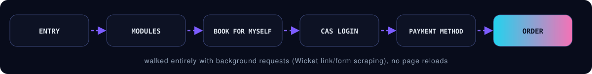
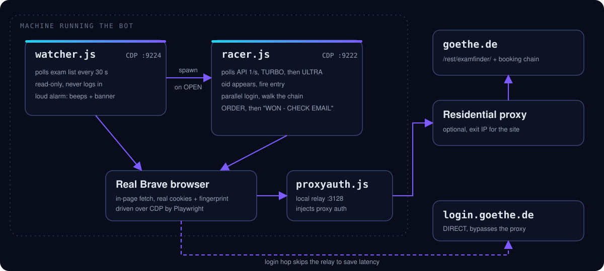

<div align="center">


<br>

**A Playwright-driven seat watcher and booking bot that polls the public Goethe exam-finder API at racing speed, fires the booking the instant a booking token appears, and walks the whole reservation to the end.**

<br>


<br>

<a href="#how-it-wins">How it wins</a> &nbsp;|&nbsp;
<a href="#architecture">Architecture</a> &nbsp;|&nbsp;
<a href="#quick-start">Quick start</a> &nbsp;|&nbsp;
<a href="#scripts">Scripts</a> &nbsp;|&nbsp;
<a href="#options">Options</a> &nbsp;|&nbsp;
<a href="#safety-rails">Safety</a> &nbsp;|&nbsp;
<a href="#legal-and-ethics">Legal</a>

</div>

<br>


<br>

## The problem

Goethe-Institut B1 exam seats open at an advertised time and can be gone in **under a minute**. Refreshing a page by hand is a losing game. This project removes the human latency: it watches the exam list around the clock, detects the exact moment a seat flips to bookable, and drives the booking chain faster than a person can click.



<br>

<h2 id="countries"> Works in any country</h2>

Tested on Goethe exam pages in the countries below. Any other country works too, because the exam API URL is **discovered automatically** from whatever exam page you point the bot at.


<br>

<h2 id="how-it-wins"> How it wins</h2>

| Trick | What it buys |
|:--|:--|
| One parked tab, tiny in-page `fetch`es from `robots.txt` | No page reloading at all; requests carry the browser's real cookies and fingerprint |
| Auto-armed **TURBO** (4/s, from -180 s) and **ULTRA** (12/s, last 60 s) | Catches the flip within about 0.4 s of the advertised opening time |
| Instant entry when the `oid` appears, plus parallel CAS login in a pre-warmed second tab | Login never blocks the chain (the single slowest step is done before it is needed) |
| Navigation-form login | The tab lands *directly* on the page after the login wall, with no re-fetch |
| Whole booking chain as background requests (Wicket link/form scraping) | Typical run: flip detected in under 0.4 s, entry about 1 s, ORDER-ready in about 10 to 14 s |
| Calm mode (default) vs `--fast` | Gentle 1/s rate-keeping avoids Akamai IP lockouts at mass openings |
| Human takeover fallbacks | A page that needs human input opens in the live Brave window instead of failing |

<br>

<h2 id="architecture"> Architecture</h2>



- **`watcher.js`** is the always-on, read-only sentinel. It never logs in, and sounds a loud alarm (beeps plus banner) when a row opens. It can spawn the racer automatically.
- **`racer.js`** is the sprinter: polling phases, gate hammering, and the full booking chain.
- **Real Brave over CDP** because plain automated Chromium with stealth patches gets flagged by the site's bot protection.
- **`proxyauth.js`** is a tiny local HTTP relay that injects proxy credentials for Brave. The login server is never IP-blocked, so it bypasses the proxy to shave latency off the login hop.

<br>

<h2 id="quick-start"> Quick start</h2>

**Prerequisites:** Node.js 18+ and a real **Brave** browser. The code is written for Windows (beep alarms, `taskkill` recovery, Brave exe path); Linux and macOS work with those three spots tweaked per script (see [Setup notes](#setup-notes)).

```bash
git clone https://github.com/iamirtasam/goethe-b1-racer
cd goethe-b1-racer
npm install

# your account(s): one file per identity
cp creds.example.json  creds.json

# optional but recommended: a residential proxy matching where the exam page expects you
cp proxy.example.json  proxy.json
```

> **Why the proxy?** Datacenter IPs (cloud VMs, RDPs) are commonly blocked by the Goethe site's bot protection. Plain automated Chromium gets blocked too, which is why the bot drives a *real* Brave browser. The login server (`login.goethe.de`) is never IP-blocked and bypasses the proxy automatically.

### 1. Dry-run the booking flow

No real booking happens. `--dry` stops at the review page and cancels the half-made booking so the account stays clean.

```bash
node racer.js --dry --city=Dubai --url=https://www.goethe.de/ins/ae/en/spr/prf/gzb1.cfm --tz=4
```

### 2. Watch for an opening 24/7

```bash
node watcher.js                                  # default city "Lahore" (PK page)
node watcher.js --city="Cebu City" --url=https://www.goethe.de/ins/ph/en/spr/prf/gzb1.cfm
node watcher.js --city=any                       # alarm on ANY city's open row
node watcher.js --city=Tokyo --nolaunch          # alarm only; you start the racer yourself
```

### 3. Race for real

```bash
node racer.js --city=Tokyo --url=https://www.goethe.de/ins/jp/en/spr/prf/gzb1.cfm --tz=9 --creds=creds-main.json
```

Or double-click `start-bot.bat` (edit the variables at the top first).

<br>

<h2 id="timezones"> Timezone cheat-sheet</h2>

`--tz` is the **UTC offset of the city whose page advertises the opening time**. The bot converts a string like `"04.09.2026 11:12"` into a real instant on any machine.

| City / page | `--tz` | | City / page | `--tz` |
|:--|:-:|:-:|:--|:-:|
| Tunisia | 1 | | Thailand | 7 |
| Turkey | 3 | | Philippines | 8 |
| UAE | 4 | | Japan | 9 |
| Pakistan (default) | 5 | | Bangladesh | 6 |

<br>

<h2 id="scripts"> Scripts</h2>

| Script | What it does |
|:--|:--|
| `watcher.js` | 24/7 seat watcher: read-only polling, loud alarms, optionally spawns the racer on OPEN |
| `racer.js` | The racer: polling phases, gate hammering, and the full booking chain |
| `speedtest.js` | Latency benchmark (seat API / booking step / login server); compare machines, run pre-race |
| `recorder.js` | Records a manual booking walkthrough (`recorder.json`) for reverse-engineering the flow |
| `check-pk.js` | One-shot "is the city still open?" check (adjust the URL inside for other cities) |
| `sweep.js` | One-shot availability sweep across 12 nearby countries |
| `uz.js` | One-shot scraper example for a new country's fees and dates (Uzbekistan here) |
| `proxyauth.js` | Local HTTP relay (port 3128) that injects proxy auth for Brave (started automatically) |

<br>

<h2 id="options"> Options</h2>

<details>
<summary><b>Racer options</b></summary>

<br>

```bash
node racer.js                          # live, Lahore, default creds.json (direct internet)
node racer.js --dry                    # everything except the final ORDER click
node racer.js --city="Bangkok"         # any city substring of the exam list
node racer.js --date=19.09             # only book rows whose date contains this
node racer.js --url=<exam page>        # any country's Goethe B1 page
node racer.js --tz=6                   # UTC offset the page's advertised times are in
node racer.js --creds=creds-main.json
node racer.js --fast | --calm=0        # switch back to aggressive mode (calm is the default)
node racer.js --cool=60                # 429 cooldown base in seconds (calm default: 30)
node racer.js --lead=99999             # force TURBO right now (testing)
node racer.js --prehammer              # experimental: fire proto-booking URLs seconds before opening
node racer.js --port=9222 --profile=... # custom CDP port / Brave profile (normal usage: leave defaults)
```

**Race-day rules (the 04.09 lesson)**

- The bot enters **calm mode by default**: patient gate retries whose gap grows 1.5s → ~4s,
  never hammering — an IP that trips Akamai's limit gets blind for ~30 minutes while
  the seats drain.
- If you ever see `HTTP 429` twice, that exit IP is burned: **start a second racer on
  another IP** (`--proxy=proxy-2.json --port=9223 --profile=... --relay=3129 --creds=...`)
  and give the first one `--cool=60`.
- Timing now comes from the v3 API's own UTC stamps (`bookFromStamp`) — no timezone
  guessing — with the old text-time path as fallback (`--tz` only matters there).

**Running a second racer for a friend on the same machine**

```bash
node racer.js --port=9223 --profile=brave-profile-friend \
  --proxy=proxy-friend.json --relay=3129 --creds=creds-friend.json --city=<their city> ...
```

This starts a fully independent browser, proxy exit, and relay. Only one racer per account at a time (a second login kills the session).

</details>

<details>
<summary><b>Watcher options</b></summary>

<br>

```bash
node watcher.js --city=<city>           # filter watched rows (substring)
node watcher.js --city=any              # any location
node watcher.js --interval=30           # poll period in seconds (default 30)
node watcher.js --nolaunch              # alarm only, never auto-start the racer
node watcher.js --url=<exam page>       # country page to watch (default: PK B1 page)
node watcher.js --port=9224 --profile=watcher-profile
node watcher.js --tag=w1 --logfile=watcher-1
node watcher.js --racer-args="--port=9223 --profile=brave-profile-friend --relay=3129"
                                        # verbatim extra flags handed to the spawned racer
```

</details>

<br>

<h2 id="safety-rails"> Safety rails</h2>

- **`--dry`** stops at the review page and cleans up (closes the booking and confirms CANCEL BOOKING) so no half-booking lingers.
- Leftover unconfirmed bookings on the account are detected and **discarded automatically** instead of blocking the flow.
- Never clicks **BOOK FOR MY CHILD**, only **BOOK FOR MYSELF**.
- Race-lost wording ("slot full", "keine Plätze", "max participants", and so on) is detected mid-chain and the bot returns instantly to seat-hunting instead of wasting the session.
- Stuck pages (needing manual form input) raise a loud alarm and open the page in Brave for a human instead of guessing.
- Crashed tabs and dead browsers are restarted automatically mid-race; failed polls back off exponentially instead of hammering.
- **429 blocks are answered by backing off**, never hammering. Calm mode exists because of a measured lesson: at one mass opening, aggressive mode got the exit IP 429-blocked 11 s after the flip, and the IP sat blind for about 28 minutes while the seats drained.

<br>

<h2 id="setup-notes"> Setup notes</h2>

- **Windows as-is.** The scripts use `[console]::beep` alarms, `taskkill` recovery, and Brave paths. On Linux/macOS, swap the PowerShell beeps for `paplay` / `afplay`, `taskkill` for `pkill`, and the Brave path constant in the scripts.
- **Real Brave over CDP** (`--remote-debugging-port`, default 9222). Don't close the Brave window it opens while a race is on.
- **Forensic logs.** `racer.log` and `watcher.log` are human-readable; the `-events.jsonl` files record **every poll, fetch, flip, and login** with millisecond timestamps. Diff two runs side by side after a loss.
- **New countries.** For countries outside the pre-mapped institute IDs in `racer.js` (`pk` / `ae` / `bd` / `om`), the fallback URLs just need extending. The primary discovery path (reading the API URL off the page itself) already works for every country.
- **Stack:** plain Node.js, Playwright (CDP driving), and a raw `http` / `net` relay. No frameworks, no ML.

<br>

<h2 id="project-layout"> Project layout</h2>

```text
goethe-b1-racer/
|-- racer.js               # polling phases + gate hammering + booking chain
|-- watcher.js             # 24/7 read-only seat watcher, alarms, auto-launch
|-- proxyauth.js           # local relay that injects proxy auth (port 3128)
|-- speedtest.js           # latency benchmark
|-- recorder.js            # records a manual booking walkthrough
|-- check-pk.js            # one-shot "still open?" check
|-- sweep.js               # one-shot availability sweep (12 countries)
|-- uz.js                  # one-shot scraper example (Uzbekistan)
|-- start-bot.bat          # Windows launcher
|-- creds.example.json     # account template  -> copy to creds.json
|-- proxy.example.json     # proxy template    -> copy to proxy.json
`-- package.json
```

<br>

<h2 id="legal-and-ethics"> Legal and ethics</h2>

> [!WARNING]
> This tool automates interaction with goethe.de, whose systems may not welcome that. It was built on the author's own accounts, for the author's own exam, to beat the "the seat was gone in 40 seconds" problem, not to outbid humans at scale.
>
> Use it for **your own seat**, one race at a time, at sane polling rates (the code's conservative defaults). Check the Terms of Service of whatever service you automate and the clock on your exam opening. Please don't run 50 of these.

<br>

<h2 id="contributing"> Contributing</h2>

PRs with new-country scout reports are welcome. If you add support for a country, include the page URL, the `--tz` offset, and the institute ID you found.

<br>

<h2 id="license"> License</h2>

ISC. See `package.json`.

<br>

<div align="center">

<sub>Built to beat the 40-second seat window. Use it responsibly.</sub>

</div>
